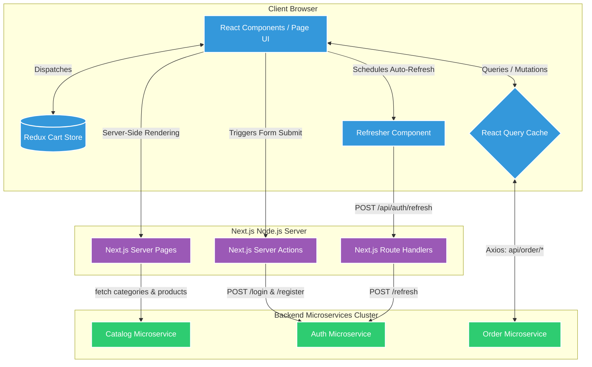
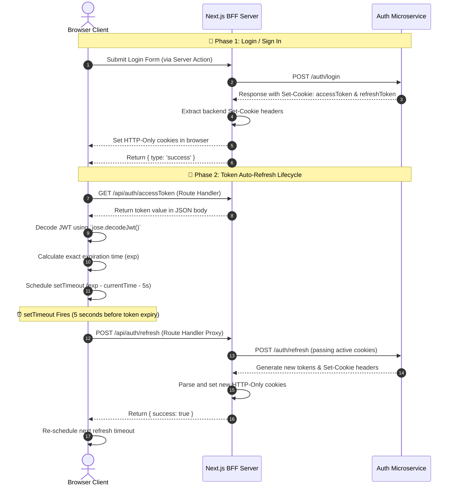

# 🍕 Pizza Delivery Client UI - Architecture & System Design

This document details the architectural layout, frontend data flow, state management paradigms, and integration patterns of the **Pizza Delivery Client UI** application.

---

## 🧭 High-Level Summary

The **Client UI** is a modern, high-performance web frontend for the Pizza Delivery Platform. Built with **Next.js (v14.1.4, App Router)**, **React (v18)**, **TypeScript**, and **TailwindCSS**, it is optimized for speed, Search Engine Optimization (SEO), and premium user experiences.

### Key Architectural Highlights
*   **BFF (Backend-for-Frontend) Proxy**: Intercepts cookie management on the server side using Next.js Server Actions and Route Handlers, securing sensitive authentication tokens (HTTP-only) from client-side scripts.
*   **Decoupled Dual-State System**:
    *   **Local UI State (Redux Toolkit)**: Manages ephemeral, high-interaction states like shopping cart items, complete with localStorage persistency.
    *   **Server Cached State (React Query)**: Manages dynamic server state queries and mutation operations (e.g. checkout forms, coupons) with automatic cache invalidation.
*   **First-Class Multi-Tenancy**: Dynamic store selection (restaurant tenant) via routing queries, enabling instant menu reloads tailored to individual franchise locations.
*   **Seamless Token Auto-Refresher**: Client-side scheduled refresh cycle driven by token expiry decoders, running invisibly in the background.

---

## 🗺️ System Interaction Architecture

The Next.js client acts as a frontend shell and a BFF layer, orchestrating requests between the client browser and backend microservices:



---

## 🔒 Session & Token Management Flow

Since authentication tokens are served inside **HTTP-only, SameSite=Strict** cookies for security, the client browser's JavaScript cannot read them directly. The following diagram illustrates how the Next.js BFF bridges this gap:



---

## 🛠️ Step-by-Step Walkthrough of Frontend Design Patterns

### 1. SSR-Safe Redux Hydration (`StoreProvider.tsx`)
In Next.js App Router, using Redux naively can lead to **hydration mismatches** because the server-side markup is rendered without localStorage data, while the client has access to it.
*   **The Solution**: The `StoreProvider` creates the Redux store lazily using a `storeRef` inside a `useRef` hook.
*   **The Hydrator**: During the first render *only on the client side*, it verifies `localStorage` availability, parses stored cart items, and dispatches the action `setInitialCartItems(parsedItems)` to sync state safely without triggering SSR errors.

### 2. Cart Item Hashing & Uniqueness (`cartSlice.ts`)
To support customizable pizzas (with selective toppings and size configurations):
*   Adding items doesn't rely solely on product IDs.
*   The system applies a hashing utility `hashTheItem()` to the combination of `_id`, selected `priceConfiguration`, and `selectedToppings`.
*   This hash serves as a unique primary key inside the cart. Adding a medium cheese pizza with double pepperoni produces a different hash than a large cheese pizza with mushrooms, ensuring they represent separate cart rows while identical orders increment the quantity (`qty`).

### 3. Server-Driven Menu Partitioning (`(home)/page.tsx`)
Multi-tenancy is integrated at the routing layer:
*   The Header component fetches the active list of restaurant tenants/franchises from `/api/auth/tenants`.
*   The client selects a restaurant via a dropdown `<TenantSelect>`.
*   This triggers `router.push('/?restaurantId=tenantId')` updating the URL search parameters.
*   The page, being a Server Component, streams category and product payloads directly from the Catalog Microservice filtered by that `tenantId`, resulting in fast page speeds.

---

## ⚠️ Pitfalls, Edge Cases & Operational Gotchas

> [!WARNING]
> ### 32-Bit Integer Overflow in setTimeout
> In `src/components/custom/refresher.tsx`, `setTimeout` is scheduled to fire just before token expiry.
> *   **The Pitfall**: The delay argument in JavaScript `setTimeout` is stored as a 32-bit signed integer. The maximum delay is `2147483647` milliseconds (approximately 24.8 days). 
> *   **The Risk**: If the JWT access token lifetime is configured to be longer than 24.8 days, the timeout overflows and triggers **immediately**, leading to an infinite refresh loop.
> *   **The Guard**: Ensure your Access Token lifetime (`JWT_ACCESS_TOKEN_EXPIRY`) remains well below 24 days (typically 15 minutes to 1 day).

> [!IMPORTANT]
> ### LocalStorage Accessibility on Client Components
> Because the global `<Header>` utilizes shopping cart indicators, it depends on the Redux store. To prevent Server-Side Rendering from trying to parse browser `window` properties:
> *   The `<CartCounter>` is loaded dynamically with Server-Side Rendering disabled:
>     ```typescript
>     const CartCounterWithoutSSR = dynamic(() => import('./cart-counter'), { ssr: false });
>     ```
> *   This ensures Next.js does not attempt to render the cart count badge on the server, avoiding HTML hydration mismatches.

> [!NOTE]
> ### Double Cookie Domains
> In local development, the `MAIN_DOMAIN` variable is empty, making cookies default to `localhost`. In production, ensure both your Auth Service and Next.js BFF share the same top-level domain scope (`Config.MAIN_DOMAIN`) so the cookies set by the Server Actions are sent with subsequent Axios API calls.
